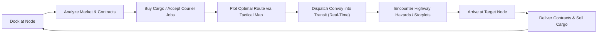
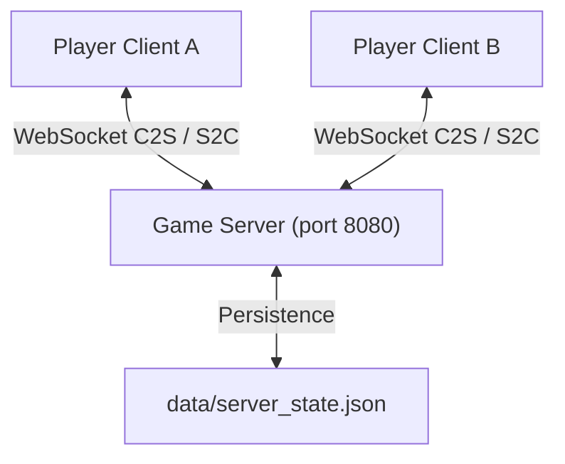

# TERMINAL HAUL

**Cyberpunk Tactical Trade & Convoy Simulation [2099]**

*Terminal Haul* is an open-architecture, real-time tactical freight simulation set across the fractured highways and sovereign corporate enclaves of post-collapse North America. Operating from the retro-futuristic cockpit of the **Iron Nomad MK-IV** armored transport rig, players navigate an authoritative 200-node tactical grid, exploit real-time dynamic market shifts driven by Goal-Oriented Action Planning (GOAP), complete high-stakes courier contracts, survive quality-driven narrative storylets, chat on global frequencies, and compete on a live Net Worth Leaderboard with other haulers.

---

## Table of Contents
1. [Core Premise & Gameplay Loop](#core-premise--gameplay-loop)
2. [Interface Anatomy & Panel Breakdown](#interface-anatomy--panel-breakdown)
3. [Game Systems & Mechanics Explained](#game-systems--mechanics-explained)
   - [Time Dilation & Real-Time Simulation](#time-dilation--real-time-simulation)
   - [Tactical Geography & Movement Physics](#tactical-geography--movement-physics)
   - [Dynamic Economy & GOAP Shifts](#dynamic-economy--goap-shifts)
   - [Commodities & Cargo Manifest](#commodities--cargo-manifest)
   - [RPG Qualities & Faction Standings](#rpg-qualities--faction-standings)
   - [Narrative Storylet Engine](#narrative-storylet-engine)
   - [Courier Contracts & Cargo Loading](#courier-contracts--cargo-loading)
   - [Net Worth & Career Scoring](#net-worth--career-scoring)
4. [Multiplayer & Persistent Backend](#multiplayer--persistent-backend)
   - [Global Frequency Chat](#global-frequency-chat)
   - [Live Net Worth Leaderboard](#live-net-worth-leaderboard)
   - [Authoritative Synchronized Economy](#authoritative-synchronized-economy)
5. [Automatic State Persistence](#automatic-state-persistence)
6. [Visual & Audio Design](#visual--audio-design)
7. [Installation & Architecture](#installation--architecture)
8. [Testing & Verification](#testing--verification)

---

## Core Premise & Gameplay Loop

In the year 2099, centralized government is a relic of the past. Continental logistics are sustained by independent haulers piloting armored rigs across seven contested sectors. You begin docked at **Omaha Silo-1** with **2,500 ₵ (Credits)** and a modest starting cargo hold.

### The Hauler Loop:


1. **Dock & Scan**: Review local commodity prices and available delivery contracts at your current location.
2. **Procure**: Purchase undervalued goods or sign courier contracts that supply mission-specific freight.
3. **Plot & Dispatch**: Select your destination on the 2D geographic projection. The navigation system calculates shortest-hop trajectories, travel time, and hazard profiles.
4. **Transit**: Ride out real-time travel across sector highways. Manage random highway encounters, corporate inspections, pirate ambushes, and distress beacons.
5. **Fulfill & Profit**: Sell commodities to nodes with deficit demand, turn in completed contracts before deadlines expire, repair hull damage, and build your Net Worth.

---

## Interface Anatomy & Panel Breakdown

The terminal layout uses a high-density, three-column CRT monitor interface:

```
+-----------------------------------------------------------------------------------------+
| [TERMINAL HAUL] RIG: Iron Nomad MK-IV | DAY 1 - 14:20 | NET: LIVE | AUDIO: ON | PALETTE |
+------------------------------------+-----------------------------+----------------------+
| LEFT COLUMN: CONVOY STATUS         | CENTER DASHBOARD (TABBED)   | RIGHT COLUMN: NAV & COMMS
| - Rig Callsign & Status (DOCKED)   | [MAP] [MARKET] [CONTRACTS]  | - Route Planner      |
| - Hull Integrity Gauge (100%)      | [QUALITIES] [LEADERBOARD]   | - Sector Filter      |
| - Cargo Capacity (7.0 / 35.0 T)    |                             | - Hop ETA & Distance |
| - Liquid Credits (2,500 ₵)         |                             | - [DISPATCH CONVOY]  |
| - Total Net Worth (6,850 ₵)        |                             | -------------------- |
| - Total Distance Traveled (km)     |                             | [SYSTEM LOG]         |
| - Active Cargo Manifest            |                             | [GLOBAL FREQUENCY]   |
|   (Grain, Batteries, Chips, etc.)  |                             | (Live Chat Input)    |
+------------------------------------+-----------------------------+----------------------+
```

### 1. Terminal Header
- **RIG Callsign**: Identifies your active hauler vehicle (`Iron Nomad MK-IV`).
- **Telemetry Clock**: Displays game day and digital time (`DAY X — HH:MM`).
- **Network Status Badge**: Indicates real-time WebSocket connection status (`NET: LIVE [1X REAL-TIME]`).
- **Audio Toggle**: Cycles pure Web Audio procedural synthesis between `AUDIO: ON` and `AUDIO: OFF`.
- **Palette Switcher**: Cycles monochrome CRT phosphor themes:
  - `PALETTE: CYAN` (Default high-tech cyber-terminal).
  - `PALETTE: AMBER` (Industrial wasteland orange amber).
  - `PALETTE: GREEN` (Classic militarized green phosphor).
- **Reset Profile**: Confirmation-guarded emergency wipe to restart carrier telemetry from baseline.

### 2. Left Column: Convoy & Inventory Telemetry
- **CONVOY STATUS**: Indicates whether your rig is safely `DOCKED` at a facility or `IN_TRANSIT` on the open highway.
- **HULL INTEGRITY**: Structural health percentage of your rig. Damage sustained in ambushes or collisions slows movement speed. Reaching 0% triggers emergency distress protocols.
- **CARGO CAPACITY**: Measured in metric tons (**T**). Shows current load vs maximum chassis rating (default: 35.0 T). Exceeding maximum weight prevents departure.
- **LIQUID CREDITS (₵)**: Immediate spendable currency used for purchasing goods, accepting collateralized contracts, paying bribes, or repairing your chassis.
- **TOTAL NET WORTH**: Sum of liquid credits plus current real-time market liquidation value of all cargo units in your hold.
- **TOTAL DISTANCE TRAVELED**: Cumulative odometer tracking kilometers logged across North America.
- **CARGO MANIFEST**: Live itemized inventory showing held units, individual unit weights, total weight per line item, and immediate sell buttons when docked.

### 3. Center Dashboard: Tabbed Subsystems
- **`[GEOGRAPHIC MAP]`**: Interactive 2D tactical projection rendered with D3-geo and TopoJSON. Shows all 200 nodes, sector boundaries, faction ownership, current position, route vectors, and interactive hover HUD inspection.
- **`[COMMODITY MARKET]`**: Live order board with dynamic buy/sell quotes, price trend indicators (`▲` / `▼`), supply/demand modifiers, and GOAP faction shift rates.
- **`[HAUL CONTRACTS]`**: Courier mission terminal split into *Available Contracts* (local pickups) and *Active Hauls* (in-progress deliveries with destination trackers, deadlines, and delivery buttons).
- **`[QUALITIES & FACTIONS]`**: Carrier character profile detailing RPG traits (Street Cred, Tech Literacy, Contraband Mastery, Heat, etc.) and reputation standing across the 5 factions.
- **`[NET WORTH LEADERBOARD]`**: Live competitive cluster rankings displaying rank podiums (#1 Gold, #2 Silver, #3 Bronze), online/offline status, net worth, deliveries, distance, and career ratings.

### 4. Right Column: Route Navigation & Tactical Communications
- **SECTOR FILTER**: Limits destination selection to nodes within a specific geopolitical sector or allows continent-wide searches.
- **DESTINATION SELECTOR**: Dropdown to select any reachable hub on the tactical grid.
- **ROUTE TELEMETRY**: Displays total hops, total distance ($D_{\text{km}}$), estimated transit duration ($T_{\text{sec}}$), and next waypoint.
- **AUTO-ADVANCE CHECKBOX**: When enabled, the navigational computer automatically dispatches your rig to the next hop along a multi-stop trajectory upon clearing each waypoint.
- **COMMUNICATIONS TERMINAL**:
  - `[SYSTEM LOG]`: Internal rig telemetry feed recording transactions, transit dispatches, arrivals, and storylet outcomes.
  - `[GLOBAL FREQUENCY]`: Live, multi-user WebSocket chat channel connecting all active haulers on the server cluster.

---

## Game Systems & Mechanics Explained

### Time Dilation & Real-Time Simulation
- **Persistent Clock Ratio**: $1\text{ Game Day} = 2\text{ Real Hours} = 7,200\text{ Real Seconds}$.
- **Multiplier**: Locked to $1.0\times$ real-time speed to maintain synchronization across all connected players in the shared persistent economy.
- **Time Representation**: Formatted as `DAY {D} — {HH}:{MM}` where 1 real second represents 12 simulated seconds.

### Tactical Geography & Movement Physics
The game map models 200 tactical nodes across North America utilizing D3-geo's Albers USA conic projection (`d3.geoAlbersUsa()`).
- **Euclidean Distance Formula**:
  $$\text{distNorm} = \sqrt{(x_2 - x_1)^2 + (y_2 - y_1)^2}$$
  $$D_{\text{km}} = \text{distNorm} \times 35.0$$
- **Transit Duration Formula**:
  $$T_{\text{seconds}} = \frac{D_{\text{km}}}{V_{\text{base}} \times \text{SpeedRating}}$$
  Where $V_{\text{base}} = 1.0\text{ km/sec}$ and `SpeedRating` defaults to $1.0$ (modified by hull damage or rig upgrades).
- **Multi-Hop Pathfinding**: Built on Breadth-First Search (BFS) / Dijkstra graph traversal in `RouteGraph`, routing convoys safely through interconnected road nodes.

### Dynamic Economy & GOAP Shifts
Market prices are never static. Every node continuously calculates buy and sell prices based on:
1. **Base Commodity Value** ($P_{\text{base}}$).
2. **Local Supply / Demand Index** ($S_{\text{local}}$): Nodes producing a good sell at deep discounts; nodes consuming it pay steep premiums.
3. **GOAP Faction Modifiers** ($M_{\text{goap}}$): Autonomous AI factions simulate macro-economic initiatives (e.g., wartime fortification, grid collapse, medical epidemics) that shift commodity price multipliers continent-wide every $\sim 0.05$ Game Days (6 minutes).
4. **Cluster Supply/Demand Ripple**: High-volume purchases and sales by human players shift market balances across the authoritative server.

### Commodities & Cargo Manifest
| Commodity | Base Price | Unit Weight | Description & Role |
| :--- | :---: | :---: | :--- |
| **Synthetic Grain** | 50 ₵ | 0.5 T | Essential foodstuff; low profit margin, high volume, low market volatility. |
| **Hydro-Batteries** | 120 ₵ | 1.0 T | High-capacity industrial power cells; steady industrial demand. |
| **Cyberware Optics** | 450 ₵ | 0.2 T | High-value precision cybernetic augments; high profit-to-weight ratio. |
| **Neural Processing Chips** | 800 ₵ | 0.1 T | Advanced computing substrates; extremely lightweight, premium tech cargo. |
| **Cryo-Medical Pods** | 1,200 ₵ | 2.5 T | Heavy medical equipment; requires substantial chassis cargo capacity. |
| **Bio-Toxins [Contraband]** | 2,500 ₵ | 0.8 T | Illicit chemicals. Huge profit margins; triggers security scans and raises **Heat**. |

### RPG Qualities & Faction Standings
Your carrier profile is shaped by narrative qualities that influence storylet choices, dialogue options, and black market access:

#### Carrier Qualities:
- **Street Cred**: Underground prestige. Unlocks back-alley brokers and deters raider attacks.
- **Tech Literacy**: Mastery of electronics. Allows hacking security checkpoints and repairing your rig in the field.
- **Contraband Mastery**: Smuggling skill. Reduces the chance of security detecting illicit bio-toxins during cargo scans.
- **Cyberware Level**: Augmentation grade. Grants combat advantages during physical highway ambushes.
- **Enclave Permits**: Authorized clearance required to dock at elite corporate nodes without paying fines.
- **Heat**: Law enforcement alert status. Accrues when transporting contraband or violating corporate law. High Heat increases hostile roadblock inspections.
- **Glitch Rating**: Hardware/neural instability. Accrues when running cracked cyberware or interfacing with anomalies.

### RPG Core Stats, Qualities & PbtA Dice Rolling

Pilots operate with four core operational stats alongside evolving carrier qualities and Powered by the Apocalypse (PbtA) 2d6 action rolls:

#### The 4 Core Stats:
- **GRIT** ($-1$ to $+3$): Chassis strength, hydraulic force, kinetic endurance, withstanding structural damage and high-g impacts.
- **EDGE** ($-1$ to $+3$): Reflexes, evasive maneuvers, highway reaction speed, dodging raider ambushes and navigating storms.
- **CYBER** ($-1$ to $+3$): Rig neural interface, electronic counter-measures, scanner spoofing, hacking, and AI collective interaction.
- **COOL** ($-1$ to $+3$): Composure, nerve, underworld negotiation, intimidation, and road diplomacy.

#### Carrier Qualities:
- `Street Cred` ($0 - 100$): Underworld reputation; grants broker access and confers $+1$ roll bonus on COOL/GRIT moves.
- `Tech Literacy` ($0 - 10$): Electronics mastery; enables scanner spoofing and confers $+1$ roll bonus on CYBER moves.
- `Contraband Mastery` ($0 - 10$): Smuggling expertise; shields illicit bio-toxins from corporate detection.
- `Cyberware Level` ($0 - 10$): Augmentation tier; unlocks neural maneuvers and confers $+1$ roll bonus on EDGE moves.
- `Enclave Permits` ($0 - 5$): Corporate clearance passes; allows express checkpoint passage and exempts docking inspection fees.
- `Heat` ($0 - 100$): Law enforcement alert status; accrues from illegal contraband runs; triggers checkpoint crackdowns.
- `Glitch Rating` ($0 - 100$): Neural corruption from experimental AI routines; causes HUD visual glitches and system feedback.

#### Powered by the Apocalypse (PbtA) 2d6 Resolution:
When resolving narrative encounters, options with action moves test your Core Stats and Qualities using a $2\text{d}6$ roll:
$$\text{Roll Total} = \text{Die}_1 (1-6) + \text{Die}_2 (1-6) + \text{CoreStat} + \text{QualityBonus}$$

- **Strong Hit ($10+$)**: Full success! Intent is achieved cleanly with premium rewards, positive quality increases, and zero negative fallout.
- **Weak Hit ($7 - 9$)**: Mixed success! You achieve your goal, but at a cost, complication, or trade-off (e.g. minor hull damage, credit fines, or increased Heat).
- **Miss ($6-$)**: Hard move / Complication! The encounter turns dangerous (hull damage, lost cargo, high Heat spike), but awards fail-forward narrative qualities (e.g., $+1$ Street Cred or $+1$ Tech Literacy from surviving the trial).

All rolls display an animated, color-coded dice breakdown in the narrative modal.

#### The 5 Competing Factions:
- **Aegis Security (`aegis`)**: Corporate security enforcing militarized order along corporate corridors.
- **Gridlock Syndicate (`gridlock`)**: Lawless road clans and smuggler cartels dominating outer wastelands.
- **Solaris Clean Energy (`solaris`)**: Megacorp managing geothermal, solar, and hydro-battery power networks.
- **Rustworks Industrial (`rustworks`)**: Heavy manufacturing collective and scrap processing guilds.
- **Neuralfront (`neuralfront`)**: Cyber-anarchist hacker underground fighting corporate neural surveillance.

### Narrative Storylet Engine
Inspired by *Sunless Sea* and *Fallen London*, the game features quality-evaluated narrative encounters:
- **Trigger Conditions**: Encounters fire during highway transit ($50\%$ route mark) or upon arrival at specific nodes.
- **Dynamic Skill Checks**: Choices verify whether your carrier possesses requisite qualities (e.g., `Tech Literacy >= 3` or `Street Cred >= 10`).
- **Branching Outcomes**: Decisions grant rewards (bonus credits, cargo salvage, faction reputation) or inflict penalties (hull damage, cargo loss, increased Heat).

#### Featured Quest Arc: "The Chilled Defector" (10-Storylet Chain)
An epic non-repeatable multi-stage narrative adventure revolving around an unregistered cryogenic coffin hauled as contraband:
- **The Mystery & The Twist:** What begins as a shady Class-IV bio-contraband courier job turns into a high-stakes corporate extraction when you discover the frozen occupant is **Dr. Elena Vance**, Chief Quantum Systems Architect of Aegis Security defecting to prevent deployment of an autonomous kill-grid.
- **5 Major Branching Decision Points:**
  1. *Telemetry Slicing vs Stasis Preservation:* Uncover her identity early or prioritize capsule refrigeration integrity.
  2. *Aegis Sweeper Ambush:* Evade into canyons (+EDGE), fast-talk with forged manifests (+COOL), ram interceptors (+GRIT), or transmit Vance's backdoored override cipher (+CYBER).
  3. *Thermal Runaway Crisis:* Hotwire the cooling pumps, flash-freeze with plasma torches, or initiate emergency resuscitation to revive Dr. Vance early as an active cabin companion.
  4. *Gridlock Syndicate Blockade:* Outsmart the raiders with a decoy toxic canister, nitro-jump their flaming barricade, plow through their gun-trucks, or broadcast a zero-day engine kill-code.
  5. *Extraction Crossroads:* Choose which faction receives Dr. Vance and her quantum architecture:
     - **Freehold Frontier:** Honor, prototype armor plating, $+35$ Rustworks rep, 7,500 ₵.
     - **Solaris Clean Energy:** Full corporate pardon, 10,000 ₵ payout, $+35$ Solaris rep, Enclave Permits +3.
     - **Neuralfront Collective:** Open-source AI mesh, $+40$ Neuralfront rep, military cyberware, 6,000 ₵.
- **Grand Finale Rewards:** Successful completion awards up to 10,000 Credits, permanent Core Stat bumps (`+1 CYBER`, `+1 EDGE`, or `+1 COOL`), rare prototype commodities (Cyberware, Neural Chips, Cryo Pods), and universal diplomatic immunity.

#### Featured Quest Saga: "A Vow Across the Ashline" (20-Storylet Epic Arc)
An expansive, non-repeatable 20-storylet branching saga following two star-crossed lovers from warring factions—Valerie Chen (Aegis tactical lieutenant) and Jax "Spark" Morales (Gridlock demolitionist):
- **Premise & The Covenant:** Haunted by a brutal war between corporate security and outlaw syndicates, Valerie and Jax pay you to smuggle them aboard your rig across the ashen divide. As continental hunter squadrons, electronic surveillance webs, and syndicate hitmen close in, you run errands, acquire forged papers, and forge their destiny.
- **5 Critical Branch Points:**
  1. *Comms Blackout vs Offensive Counter-Strike:* Purge transmitters to vanish into the static (+COOL), counter-fry the informant's relay dish (+CYBER), or emit a transponder decoy echo (+EDGE).
  2. *The Foundry at Rustworks:* Forge Titanium Neural Wedding Rings for their elopement, Demolition Detonator Ciphers for a tactical coup, or heavy rig armor plating for maximum survivability.
  3. *The Midnight Cabin Confession:* Counsel Valerie on whether living for love is the highest defiance, whether peace requires taking their oppressors' crowns, or whether to face grim fatalism side-by-side.
  4. *Syndicate Blackmail:* Frame the extortionist boss with forged cyber logs (+CYBER), coordinate an armored cabin ambush (+GRIT), or pay the extortion bribe.
  5. *Crossroads Council (Point of No Return):* The defining ideological crossroad where the player locks the trajectory: Elopement, Faction Coup, or Tragic Reckoning.
- **Three Divergent Grand Finale Endings:**
  - 🕊️ **Ending 1: The Sunset Wedding at the Pacific Sanctuary [ELOPEMENT]**: Escape beyond the continental frontier where Valerie and Jax exchange neural rings in a sunlit redwood greenhouse.
    - *Rewards:* 8,500 ₵, full 100% hull restore, 3x Batteries, 2x Cryo Pods, permanent **$+1$ COOL**, $+40$ Rustworks rep, $+3$ Enclave Permits, $-50$ Heat.
  - 👑 **Ending 2: The Dual Crowns [FACTION COUP]**: Valerie and Jax lead a lightning strike on the joint command bunker, toppling the old generals and seizing supreme command of both Aegis Security and the Gridlock Syndicate.
    - *Rewards:* 15,000 ₵ treasury bounty, 3x Cyberware, 3x Neural Chips, permanent **$+1$ CYBER**, $+35$ Aegis rep, $+35$ Gridlock rep, $+4$ Enclave Permits, $+25$ Heat.
  - ⚔️ **Ending 3: The Iron Requiem [TRAGIC LAST STAND]**: Cut off on the center span of an irradiated suspension bridge, Jax and Valerie stand back-to-back holding off army squads, detonating the bridge charges hand-in-hand so your rig can break through the other side.
    - *Rewards:* 6,000 ₵, salvaged titanium rings, 2x Cyberware, 2x Batteries, permanent **$+1$ GRIT**, $+25$ Street Cred, $-40$ Heat, and an enduring wasteland legend.

### Courier Contracts & Cargo Loading
Procedural delivery contracts are generated at every node with specified parameters:
- **Cargo Reservation**: Accepting a contract reserves the necessary tonnage in your cargo hold.
- **Collateral & Deadlines**: High-tier contracts require modest collateral deposits and feature strict delivery deadlines measured in game days.
- **Destination Verification**: When your convoy reaches the target node, the contract interface enables the `[DELIVER]` action, awarding the agreed payout, clearing reserved hold space, and boosting faction standing.

### Net Worth & Career Scoring
Leaderboard standings are calculated using an authoritative financial formula:
$$\text{Net Worth} = \text{Liquid Credits} + \sum (\text{Held Quantity}_i \times \text{Current Node Unit Sell Price}_i)$$
$$\text{Career Score} = \text{Net Worth} + (\text{Completed Contracts} \times 1,500) + \left(\frac{\text{Distance Traveled (km)}}{10}\right)$$

#### Career Rank Titles:
- `Scrap Runner` (0 – 10,000 pts)
- `Wasteland Courier` (10,001 – 25,000 pts)
- `Highway Veteran` (25,001 – 60,000 pts)
- `Syndicate Contractor` (60,001 – 150,000 pts)
- `Master Hauler` (150,001 – 350,000 pts)
- `Continental Kingpin` (350,000+ pts)

---

## Multiplayer & Persistent Backend

*Terminal Haul* operates a persistent client-server architecture powered by WebSockets (`ws://localhost:8080`):



### Global Frequency Chat
- Accessible via the `[GLOBAL FREQUENCY]` tab in the lower-right communications log.
- Supports persistent cluster-wide communication across all connected haulers with timestamps and callsigns.
- Server maintains the last 100 messages on disk in `data/server_state.json`.

### Live Net Worth Leaderboard
- Real-time ranking tab on the center dashboard with visual status dots:
  - 🟢 **Online**: Hauler actively connected to the server cluster.
  - ⚫ **Offline**: Docked hauler whose profile is preserved in cluster memory.
- Podium badges (#1 Gold, #2 Silver, #3 Bronze) and personal rank telemetry badge.

### Authoritative Synchronized Economy
- When players execute large trade volumes, `C2S_TRADE_EVENT` messages transmit adjustments to the central server.
- The server broadcasts shared price adjustments (`S2C_MARKET_SYNC`) to all connected clients, allowing haulers to influence supply and demand across the entire continent.

---

## Automatic State Persistence

The game uses **zero-touch continuous persistence**:
- **Automatic Hydration**: On launch or browser refresh, `GameStore` loads state directly from HTML5 `localStorage` (`TERMINAL_HAUL_SAVE`).
- **Event-Driven Autosave**: State is written immediately whenever you:
  - Buy or sell commodities.
  - Accept, load, deliver, or abandon contracts.
  - Make narrative decisions in storylet modals.
  - Dispatch, cancel, or complete convoy routes.
- **Background Interval**: Saves every 10 seconds during transit.
- **Exit Protection**: A `beforeunload` listener commits state when the browser tab is closed.
- **Cloud Backup**: Every local save automatically backs up a serialized JSON payload to `data/server_state.json` via the backend server.

---

## Visual & Audio Design

### Procedural Web Audio Synth
All sound effects are synthesized in real-time via the browser's native Web Audio API (`AudioContext`) with **zero external sound files**:
- **UI Click**: Dual-frequency square wave transient ($800\text{ Hz} \to 1,200\text{ Hz}$, $35\text{ ms}$).
- **Trade Ping**: Polyphonic dual-sine harmonic chime ($587\text{ Hz} + 880\text{ Hz}$, exponential decay).
- **Event Alarm**: Sawtooth minor-third alarm ($330\text{ Hz} \to 440\text{ Hz}$).
- **Engine Rumble**: Deep procedural brown-noise audio buffer with continuous modulation active during convoy transit.

### Phosphor CRT Shader Aesthetics
- **Scanlines & CRT Curve**: Authentic CRT raster scanlines overlayed across the viewport.
- **Monochrome Phosphor Palettes**: High-contrast cyberpunk styling available in Cyan, Amber, and Green.
- **Tactical Responsive Canvas**: Canvas-rendered 2D continental geography with crisp vector nodes and glowing routes.

---

## Installation & Architecture

### Prerequisites
- Node.js (v18+ recommended)
- npm

### Project Structure
```
Terminal Haul/
├── data/
│   └── server_state.json        # Persistent backend database (chat, trades, leaderboard)
├── src/
│   ├── audio/
│   │   └── soundFX.ts           # Pure Web Audio procedural sound synthesizer
│   ├── constants/
│   │   ├── nodes.ts             # 200 tactical nodes with geographic coordinates
│   │   └── worldData.ts         # Faction data, commodities, and sectors
│   ├── network/
│   │   └── multiplayerClient.ts # WebSocket client protocol handler
│   ├── server/
│   │   ├── gameServer.ts        # Authoritative WebSocket server (port 8080)
│   │   ├── storage.ts           # Server JSON persistence engine
│   │   └── types.ts             # Network packet and protocol contracts
│   ├── sim/
│   │   ├── clock.ts             # Simulation clock (1 Game Day = 2 Real Hours)
│   │   ├── contractEngine.ts    # Procedural courier contract generation & validation
│   │   ├── economy.ts           # Local supply/demand and pricing formulas
│   │   ├── goap.ts              # Goal-Oriented Action Planning macro-economy
│   │   ├── movement.ts          # Convoy transit physics and speed calculations
│   │   ├── narrativeEngine.ts   # Storylet evaluation and condition checks
│   │   ├── persistence.ts       # LocalStorage serialization engine
│   │   └── routeGraph.ts        # Dijkstra / BFS route pathfinding
│   ├── state/
│   │   └── gameState.ts         # Central reactive player state store
│   ├── styles/
│   │   └── terminal.css         # Retro CRT styling, themes, and responsive layout
│   ├── types/                   # TypeScript interfaces (nodes, cargo, storylets)
│   ├── ui/
│   │   └── mapRenderer.ts       # 2D D3-geo TopoJSON canvas map renderer
│   └── main.ts                  # Application controller and UI coordinator
├── tests/                       # Vitest unit and integration test suite
├── index.html                   # HTML5 terminal UI structure
├── package.json
└── tsconfig.json
```

### Quickstart Commands
```powershell
# 1. Install dependencies
npm.cmd install

# 2. Run test suite (71 passing tests)
npm.cmd test

# 3. Start authoritative backend server (port 8080)
npm.cmd run server

# 4. In a separate terminal, launch client development server (port 3000)
npm.cmd run dev

# 5. Build optimized production client bundle
npm.cmd run build
```

---

## Testing & Verification

The project includes an end-to-end test suite powered by **Vitest** covering all core mathematical, architectural, and gameplay systems:
- `tests/movement.test.ts`: Transit duration, progress, and speed physics.
- `tests/clock.test.ts`: Real-time clock dilation and day rollover.
- `tests/economy.test.ts`: Base pricing, node modifiers, and GOAP price variance.
- `tests/goap.test.ts`: Autonomous faction goals and world state evolution.
- `tests/contracts.test.ts`: Contract generation, expiration, cargo reservation, and delivery verification.
- `tests/storylets.test.ts`: Quality prerequisite evaluation and branching outcomes.
- `tests/navigation.test.ts`: Graph routing, hop discovery, and node connectivity.
- `tests/persistence.test.ts`: Save serialization, hydration, and migration compatibility.
- `tests/trading.test.ts`: Market order processing, credit calculations, and cargo limits.
- `tests/multiplayer.test.ts`: Authoritative WebSocket server round-trips, chat broadcasting, leaderboard syncing, and shared economy adjustments.
- `tests/audio.test.ts`: Web Audio procedural synthesizer initialization and muting.

Run all tests anytime with:
```powershell
npm.cmd test
```

---

*Terminal Haul v1.0.0 — Licensed under MIT.*
