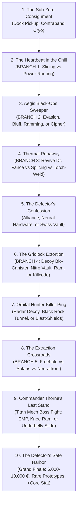
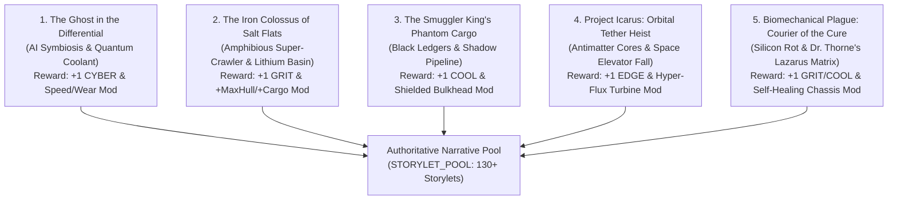
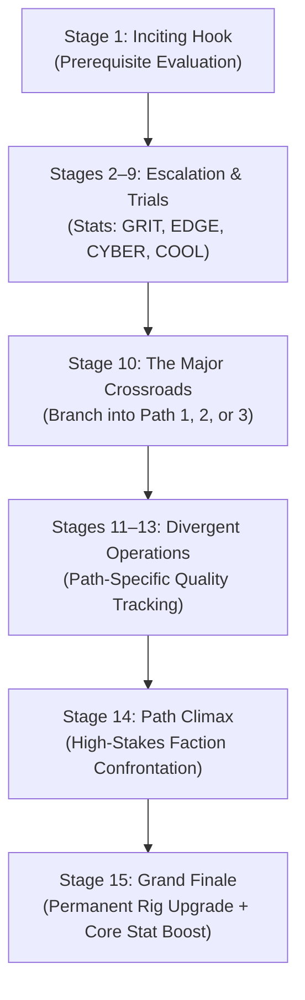
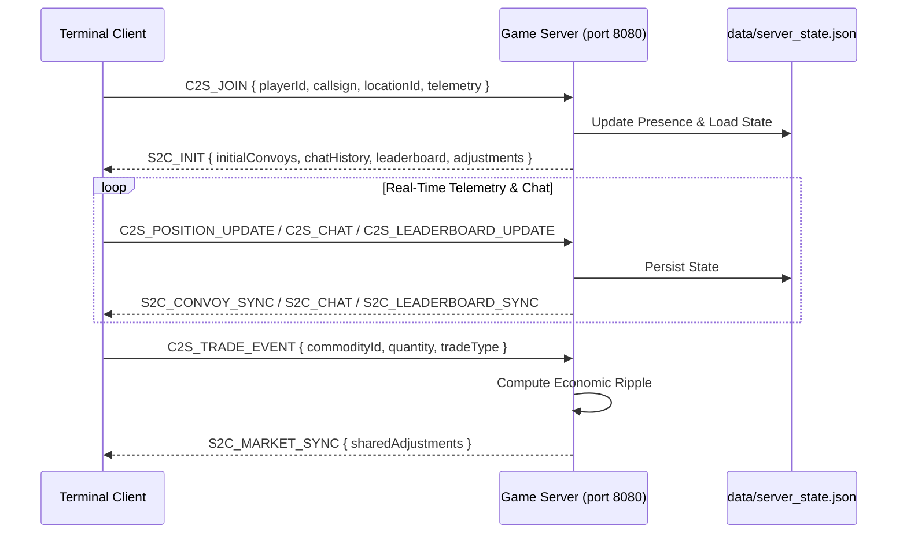

# TERMINAL HAUL — Complete Technical & System Specification

**Version:** 2.0.0  
**Status:** Authoritative / Implemented  
**Classification:** Open Architecture Technical Specification  
**Architecture:** Real-Time Client-Server, WebSockets, D3-Geo Vector Engine, Pure Web Audio API  

---

## 1. Executive Summary & Architectural Vision

**TERMINAL HAUL** is an open-architecture, real-time Cyberpunk Trade and Convoy Simulation set across the fractured geopolitical expanse of 2099 North America. Players assume command of the **Iron Nomad MK-IV**, an armored continental transport rig, traversing an authoritative network of 200 real-world based metropolitan enclaves, corporate arcologies, and wasteland trade hubs.

The system integrates seven foundational architectural subsystems:
1. **D3-Geo Tactical Continental Projection:** Real-world continental geography rendered via D3-geo and TopoJSON utilizing an Albers USA conic projection on an HTML5 canvas.
2. **Quality-Driven Narrative Engine:** A stateful storylet system inspired by *Sunless Sea* and *Fallen London*, evaluating player qualities, inventory, faction standings, and heat levels to generate branching highway encounters.
3. **Goal-Oriented Action Planning (GOAP) AI Economy:** Autonomous faction AI simulating strategic macro-economic campaigns that shift continental commodity multipliers in real time.
4. **Authoritative Real-Time WebSocket Server:** A persistent Node.js/TypeScript WebSocket cluster managing cross-player convoy presence, real-time global frequency communications, shared economic market impact, and cluster-wide net worth leaderboards.
5. **Continuous Zero-Touch Persistence:** Seamless dual-layer persistence featuring instant local hydration from `localStorage` and continuous cloud state backups to `data/server_state.json`.
6. **Pure Web Audio Procedural Synthesis:** Zero-asset procedural audio generation synthesizing UI transients, harmonic transaction chimes, alarm sirens, and modulated highway engine rumble directly via the native browser `AudioContext`.
7. **Retro-Futuristic CRT Terminal UI:** A three-column tactical cockpit interface supporting multiple monochrome phosphor themes (Cyan, Amber, Green), raster scanlines, chromatic aberration, and tabbed dashboards.

---

## 2. Core World Architecture & Factions

### 2.1 The 200-Node Continental Grid
The game world models 200 nodes positioned with geographic longitude and latitude across North America, classified into seven geopolitical sectors:

| Sector ID | Sector Name | Representative Hubs | Dominant Economic Focus |
| :--- | :--- | :--- | :--- |
| `northeast` | **Northeast Megalopolis** | Chiba-on-Hudson, Neo-Syracuse, Boston Citadel | High-tech cyberware, optics, corporate banking |
| `midwest` | **Midwest Industrial Rust** | Detroit Arcology, Chicago Citadel, Omaha Silo-1 | Synthetic grain, heavy manufacturing, hydro-batteries |
| `pnw` | **Pacific Northwest Sprawl** | Cascadia Megalopolis, Seattle Arcology, Portland Redoubt | Clean tech, neural hardware, environmental bio-domes |
| `southwest` | **Southwest Wasteland** | Mojave Sprawl, Baja Sub-City, Phoenix Redoubt | Solar energy, illegal bio-toxins, salvage operations |
| `southern` | **Southern Freehold** | Texas Freehold, Gulf Atoll Enclave, Austin Data-Sprawl | Petrochemical relics, logistics corridors, arms trading |
| `eastcoast` | **East Coast Corridors** | Atlanta Cyber-Sprawl, Appalachian Fortress | Mining, militarized corporate security outposts |
| `north` | **Northern Boreal Shield** | Quebec Bio-Dome, Laurentian Citadel | Rare minerals, cryogenic reserves, deep compute vaults |

### 2.2 Faction Matrix & Ideology
Five competing factions drive continental politics, security operations, and the autonomous GOAP economy:

| Faction ID | Faction Name | Ideology & Operations | Demanded Commodities | Produced Commodities |
| :--- | :--- | :--- | :--- | :--- |
| `aegis` | **Aegis Security Corp** | Authoritarian corporate PMC; maintains militarized highway checkpoints. | Hydro-Batteries, Neural Chips | Weapons, Legal Permits |
| `gridlock` | **Gridlock Syndicate** | Underworld cartel; controls wasteland black markets and smuggling veins. | Bio-Toxins, Cyberware Optics | Contraband, Scramblers |
| `solaris` | **Solaris Clean Energy** | Megacorp controlling geothermal, solar, and industrial power infrastructure. | Synthetic Grain, Hydro-Batteries | Energy Cells, Solar Tech |
| `rustworks` | **Rustworks Industrial** | Heavy manufacturing union and reclaimer collective. | Cryo-Medical Pods, Raw Metals | Structural Parts, Chassis Armor |
| `neuralfront` | **Neural Front** | Transhumanist cyber-insurgents fighting corporate neural tracking. | Neural Chips, Cyberware Optics | Cracked Code, Decryption Keys |

---

## 3. Time, Space & Movement Systems

### 3.1 Real-Time Simulation Clock
To ensure strict multi-client synchronization across the persistent multiplayer server, the simulation clock is locked to standard real-time execution:
* **Time Scale Ratio:** $1 \text{ Game Day} = 2 \text{ Real-World Hours} = 7,200 \text{ Real Seconds}$.
* **Multiplier:** Locked at $1.0\times$ (warp and pause disabled to maintain authoritative shared reality).
* **Tick Rate:** 1 second interval ($1 \text{ tick} \approx 0.0001388 \text{ Game Days}$).
* **Format:** `DAY {D} — {HH}:{MM}` (1 real second advances 12 simulated seconds).

### 3.2 Geographic Projection & Movement Physics
The game visualizes real-world North American geography using D3-geo's planar projection on an HTML5 canvas:
* **Haversine Distance Formula (Real Geographic Coordinates):**
  $$a = \sin^2\left(\frac{\Delta\text{lat}}{2}\right) + \cos(\text{lat}_1)\cos(\text{lat}_2)\sin^2\left(\frac{\Delta\text{lng}}{2}\right)$$
  $$c = 2\text{ atan2}(\sqrt{a}, \sqrt{1-a})$$
  $$D_{\text{km}} = \max(15, \, \text{Math.round}(6371 \times c))$$
  *(Falls back to Euclidean grid math $\max(15, \, \text{round}(\text{dist} \times 45))$ when coordinates are mock/legacy).*
* **Transit Duration Formula with Hull & Speed Attenuation:**
  $$\text{HullFactor} = \max\left(0.40, \, \min\left(1.0, \, \frac{\text{HullIntegrity}}{100}\right)\right)$$
  $$\text{EffectiveSpeed} = \max\left(0.20, \, \text{SpeedRating} \times \text{HullFactor}\right)$$
  $$T_{\text{sec}} = \max\left(10, \, \text{Math.round}\left(\frac{D_{\text{km}}}{15 \times \text{EffectiveSpeed}}\right)\right)$$
* **Convoy Maintenance & Dockside Repairs:**
  Chassis hull can be repaired at any docked facility via the UI `[REPAIR CHASSIS]` button at a fixed rate of $10\text{ ₵}$ per $1\%$ hull integrity. If hull integrity reaches $0\%$, an automated **Emergency SOS** protocol stabilizes the convoy at $25\%$ integrity and assesses an emergency towing fine and Heat penalty.

### 3.3 Multi-Hop Graph Navigation & Auto-Advance
Routing across the 200 nodes is calculated using the `RouteGraph` engine:
* **Topology:** Nodes are connected via bidirectional adjacency links based on proximity ($\le 12.0$ coordinate units).
* **Pathfinding:** Breadth-First Search (BFS) / Dijkstra computes shortest-hop routes between arbitrary origin and destination nodes.
* **Auto-Advance Protocol:** When `chkAutoAdvance` is enabled, reaching a waypoint automatically dispatches the convoy toward the next hop along the precomputed trajectory until the terminal destination is reached.

---

## 4. Four Core Stats & Quality-Driven Narrative Engine (Storylets & PbtA)

### 4.1 Narrative Engine Architecture
Inspired by *Sunless Sea*, *Fallen London*, and Powered by the Apocalypse (PbtA) tabletop RPG systems, the game combines four fundamental pilot stats, narrative qualities, and 2d6 action rolls into a reactive encounter system. Storylets are evaluated by `NarrativeEngine` during transit ($50\%$ progress check) or upon docking.

### 4.2 Four Core Stats (PbtA)
Pilots possess four core operational stats rated from $-1$ to $+3$ (clamped between $-2$ and $+4$ through career advancement):

| Core Stat | Focus Area & Mechanical Role | PbtA Action Move Examples |
| :--- | :--- | :--- |
| **GRIT** | Chassis resilience, hydraulic force, physical toughness, absorbing damage. | Smashing roadblocks, anchoring in sandstorms, heavy salvage winching, enduring neural seizures. |
| **EDGE** | Reaction speed, evasive driving, high-speed maneuvers, hazard avoidance. | Outrunning raiders, dodging sandstorm squalls, high-speed weaving, neural reflex driving. |
| **CYBER** | Rig interface, electronic counter-measures, scanner spoofing, hacking, AI mesh. | Overriding checkpoint radar, decrypting freight manifests, compiling optic drivers, EMP bursts. |
| **COOL** | Composure, nerve, underworld negotiation, intimidation, deception. | Fast-talking enclave enforcers, negotiating contraband hauls, parleying with desert nomad clans. |

### 4.3 Carrier Qualities Specification
Player progress and operational risks are measured through numerical qualities that act as narrative flags, access requirements, and roll modifiers:

| Quality Key | Type | Range | Description & Mechanical Impact |
| :--- | :---: | :---: | :--- |
| `Street Cred` | Numeric | $0 - 100$ | Underworld reputation; grants access to illegal brokers and confers $+1$ roll bonus on COOL/GRIT moves. |
| `Tech Literacy` | Numeric | $0 - 10$ | Electronics mastery; enables terminal hacking and confers $+1$ roll bonus on CYBER moves. |
| `Contraband Mastery` | Numeric | $0 - 10$ | Smuggling expertise; shields contraband and confers $+1$ roll bonus on illicit negotiations. |
| `Cyberware Level` | Numeric | $0 - 10$ | Augmentation tier; unlocks enhanced moves and confers $+1$ roll bonus on EDGE moves. |
| `Enclave Permits` | Numeric | $0 - 5$ | Corporate clearance passes; allows express checkpoint passage and prevents docking fines. |
| `Heat` | Hazard | $0 - 100$ | Law enforcement alert status; accrues when dealing contraband; triggers roadblock raids. |
| `Glitch Rating` | Hazard | $0 - 100$ | Neural corruption; accrues from experimental tech; triggers sensory hallucinations. |

### 4.4 Powered by the Apocalypse (PbtA) Resolution
When a storylet option requires an action roll (`statRoll`), resolution follows the PbtA 2d6 probability curve:

$$\text{Roll Total} = \text{Die}_1 (1-6) + \text{Die}_2 (1-6) + \text{CoreStat} + \text{QualityBonus}$$

* **Strong Hit ($10+$):** Full success. Intent is cleanly achieved with peak rewards, positive quality increases, and zero negative fallout.
* **Weak Hit ($7 - 9$):** Mixed success. Intent is achieved, but at a cost, complication, or compromise (e.g. minor hull damage, resource expenditure, or $+Heat$).
* **Miss ($6-$):** Hard move / Complication. The situation spirals out of control with severe consequences (rig hull damage, loss of credits/cargo, or high $+Heat$), but awards fail-forward narrative qualities (e.g., $+1$ Street Cred or $+1$ Tech Literacy from surviving the ordeal).

### 4.5 Storylet Schema
```typescript
export interface StoryletRequirement {
  qualities?: Record<string, number>;
  maxQualities?: Record<string, number>;
  stats?: Partial<Record<CoreStatKey, number>>;
  credits?: number;
  cargo?: Partial<Record<CommodityId, number>>;
  factionRep?: Partial<Record<FactionId, number>>;
  sector?: SectorId;
  locationId?: string;
}

export interface StoryletReward {
  qualities?: Record<string, number>;
  stats?: Partial<Record<CoreStatKey, number>>;
  credits?: number;
  cargo?: Partial<Record<CommodityId, number>>;
  rep?: Partial<Record<FactionId, number>>;
  hullIntegrity?: number;
}

export interface PbtABranchOutcome {
  effectText: string;
  rewards: StoryletReward;
}

export interface StoryletOption {
  id: string;
  label: string;
  reqs?: StoryletRequirement;
  effectText: string;
  rewards: StoryletReward;
  statRoll?: CoreStatKey;
  qualityBonusKey?: string;
  qualityBonusThreshold?: number;
  strongHit?: PbtABranchOutcome; // 10+
  weakHit?: PbtABranchOutcome;   // 7-9
  miss?: PbtABranchOutcome;      // 6-
}
```

* **Transit Encounters:** Triggered automatically at $50\%$ transit progress between nodes if eligible storylets match the player's active qualities, core stats, and location.
* **Direct Cargo Salvage:** Options rewarding `rewards.cargo` automatically verify chassis capacity and add the commodities into the player's hold.

### 4.6 Non-Repeatable Narrative Arc: "The Chilled Defector" (10-Card Chain)
A major narrative arc revolving around an unregistered cryogenic coffin hauled as contraband, containing Dr. Elena Vance—Chief Quantum Architect of Aegis Security defecting to escape liquidation:



* **Non-Repeatability Guarantee:** Every stage card defines `repeatable: false` and is tracked in `PlayerState.completedStorylets` and sequential quest stage qualities (`Cryo Extraction: 1` through `9`, terminating at `99`).
* **5 Critical Branch Points:**
  1. *Investigate vs Preserve Seal:* Uncovers Dr. Vance's identity early (`Corpo Truth Known = 1`) or protects capsule integrity (`Cryo Capsule Health = 100`).
  2. *Aegis Sweeper Response:* Choice between high-speed canyon evasion (+EDGE), forged manifest bluff (+COOL), kinetic ramming (+GRIT), or Vance's secret recall cipher.
  3. *Thermal Thaw Crisis:* Option to initiate emergency controlled thaw, awakening Dr. Vance as an active conscious cabin companion (`Dr Vance Awakened = 1`).
  4. *Syndicate Extortion Roadblock:* Choice between toxic canister deception (+COOL), nitro-boost jump (+EDGE), armored plow crush (+GRIT), or remote ECM kill-code (+CYBER).
  5. *The Destination Crossroads:* Determines the receiving faction:
     - **Freehold Frontier:** High honor, rig prototype armor, $+35$ Rustworks rep, 7,500 ₵.
     - **Solaris Clean Energy:** Executive pardon, 10,000 ₵ bounty, $+35$ Solaris rep, permanent Enclave Permits.
     - **Neuralfront Collective:** Open-source AI mesh, $+40$ Neuralfront rep, military cyberware, 6,000 ₵.

### 4.7 Non-Repeatable Narrative Saga: "A Vow Across the Ashline" (20-Storylet Chain)
An epic, 20-storylet branching saga following two forbidden lovers from warring factions—Valerie Chen (Aegis tactical lieutenant) and Jax "Spark" Morales (Gridlock demolitionist)—smuggled aboard the player's hauler rig across continental checkpoints and wasteland killzones.

```mermaid
flowchart TD
    S1["1. Ashline Rendezvous<br/>(Smuggle Lovers Aboard Rig)"] --> S2["2. Scramble at the Gate<br/>(Bio-Resonance Checkpoint)"]
    S2 --> S3["3. First Safehouse<br/>(Toll Barricade & Cabin Shelter)"]
    S3 --> S4["4. Errand: Clinic Medicine<br/>(Immunosuppressant Heist)"]
    S4 --> S5["5. The Intercepted Bounty<br/>(BRANCH 1: Comms Purge vs Counter-Trace vs Decoy)"]
    S5 --> S6["6. Errand: Rustworks Foundry<br/>(BRANCH 2: Wedding Rings vs Detonator Ciphers vs Armor)"]
    S6 --> S7["7. Jackal Ambush<br/>(Highway Ambush Defense)"]
    S7 --> S8["8. Errand: Passports<br/>(Underworld Registry Forgery)"]
    S8 --> S9["9. The Cabin Confession<br/>(BRANCH 3: Romance vs Ambition vs Fatalism)"]
    S9 --> S10["10. Aegis Interception<br/>(Gunship Dogfight & EMP Burst)"]
    S10 --> S11["11. Errand: Mesh Ghost<br/>(Quantum DNA Registry Scrub)"]
    S11 --> S12["12. Syndicate Blackmail<br/>(BRANCH 4: Frame Warlord vs Firefight vs Bribe)"]
    S12 --> S13["13. Neural Rejection Crisis<br/>(Mountain Hairpin Surgery)"]
    S13 --> S14["14. Errand: Maglev Depot<br/>(Freight Train Salvage Heist)"]
    S14 --> S15["15. Crossroads Council<br/>(BRANCH 5: Lock In Path: Elopement, Coup, or Tragedy)"]
    S15 --> S16["16. The Redline Run<br/>(Hunted Interstate Gauntlet)"]
    S16 --> S17["17. The Final Cache<br/>(Border Pre-Strike Staging)"]
    S17 --> S18["18. Sovereign Gate Lockdown<br/>(Blast-Door Assault / Bypass)"]
    S18 --> S19["19. Battle of the Divide<br/>(Path-Specific Climax Gauntlet)"]
    S19 --> S20["20. Dawn at Terminal's End<br/>(Grand Finale: 3 Distinct Destinies)"]
```



* **Non-Repeatability & State Tracking:** Every card has `repeatable: false`, logged in `PlayerState.completedStorylets` with sequential stages (`Lovers Stage: 1` through `19`, concluding at `99`).
* **5 Critical Branch Points:**
  1. *Storylet 5 (The Intercepted Bounty):* Stealth comms blackout (+COOL) vs Informant offensive fry (+CYBER) vs Transponder decoy echo (+EDGE).
  2. *Storylet 6 (Rustworks Foundry):* Forging Titanium Neural Wedding Rings (Romance path) vs Demolition Detonator Ciphers (Coup path) vs Heavy Rig Plating (Survival path).
  3. *Storylet 9 (Cabin Confession):* Counsel Valerie to live for love (+COOL) vs Fight for supreme faction dominance (+COOL) vs Acknowledge grim fatalism (+GRIT).
  4. *Storylet 12 (Syndicate Blackmail):* Frame the extortion warlord using forged cyber logs (+CYBER) vs Coordinated cabin ambush (+GRIT) vs Extortion payoff (+COOL).
  5. *Storylet 15 (Crossroads Council - Point of No Return):* The defining crossroads locking the narrative trajectory (`Lovers Chosen Path: 1, 2, or 3`).
* **Three Divergent Grand Finale Endings:**
  - **Ending 1: Sunset Wedding at the Pacific Sanctuary (Elopement):** The lovers escape across the continental frontier and wed under the redwoods.
    - *Rewards:* 8,500 ₵, full hull restore (100%), 3x Batteries, 2x Cryo, permanent **$+1$ COOL**, $+40$ Rustworks rep, $+3$ Enclave Permits, $-50$ Heat.
  - **Ending 2: The Dual Crowns (Faction Coup):** Valerie and Jax storm the command bunker, execute the warlords, and take joint command of Aegis and Gridlock.
    - *Rewards:* 15,000 ₵ treasury bounty, 3x Cyberware, 3x Neural Chips, permanent **$+1$ CYBER**, $+35$ Aegis rep, $+35$ Gridlock rep, $+4$ Enclave Permits, $+25$ Heat.
  - **Ending 3: The Iron Requiem (Tragic Last Stand):** Cut off on the bridge, the lovers detonate the charges together, sacrificing their lives so the player can break through.
    - *Rewards:* 6,000 ₵, salvage 2x Cyberware, 2x Batteries, permanent **$+1$ GRIT**, $+25$ Street Cred, $-40$ Heat, and eternal wasteland reverence.

### 4.8 Five Epic Branching Sagas (20 Storylets Each & Permanent Rig Upgrades)

To deliver vast narrative depth and tangible vehicle progression, five epic non-repeatable quest sagas—comprising **100 total hand-crafted storylets**—are woven into the continental storylet pool. Each saga features 20 sequential stages, minimum 3 options per stage, full Powered by the Apocalypse 2d6 action rolls with stat and quality bonuses, multiple branching paths, and **permanent rig chassis/engine upgrades** (`StoryletReward.rig`) alongside core stat boosts.



#### 1. The Ghost in the Differential (20 Storylets)
* **Narrative Arc:** A derelict military convoy diagnostic scan awakens an autonomous quantum intelligence named "Aura" embedded within the Iron Nomad's transmission differential. The player investigates military black-ops projects, purges corporate hunter-viruses, and decides Aura's ultimate evolution.
* **Stage Tracking & Qualities:** `Ghost Stage` (0 to 19, ending at 99), `Ghost Bond`, `Ghost Chosen Path` (1: Full Symbiosis, 2: Cyber-Weapon, 3: Autonomous Sanctuary).
* **Permanent Rig Rewards:**
  - *Symbiosis Path:* `Iron Nomad - Ghost Symbiont` (+20% speed rating, +15 max hull, +1 CYBER).
  - *Weapon Path:* `Iron Nomad - Quantum Disruptor` (+10% speed rating, +15 max hull, +1 CYBER, +1 EDGE).
  - *Sanctuary Path:* `Iron Nomad - Free Signal` (+15% speed rating, +10 max hull, +1 CYBER, +1 COOL).

#### 2. The Iron Colossus of the Salt Flats (20 Storylets)
* **Narrative Arc:** In the blinding white lithium salt flats of the Southwest Wasteland, reclaimer crews discover an abandoned pre-war super-crawler dreadnought ("The Behemoth"). The player leads heavy transport operations, mountain blasting, fuel convoy runs, and corporate skirmishes to claim the mineral wealth.
* **Stage Tracking & Qualities:** `Colossus Stage` (0 to 19, ending at 99), `Colossus Trust`, `Colossus Chosen Path` (1: Sovereign Salt Commune, 2: Corporate Lease, 3: Armored Mobile Fortress).
* **Permanent Rig Rewards:**
  - *Commune Path:* `Iron Nomad - Colossus Chassis` (+35 max hull, +5 cargo capacity, +1 GRIT).
  - *Corporate Path:* `Iron Nomad - Lithium Hauler` (+25 max hull, +8 cargo capacity, +1 GRIT, +1 COOL).
  - *War-Rig Path:* `Iron Nomad - Salt Dreadnought` (+45 max hull, +1 GRIT).

#### 3. The Smuggler King’s Phantom Cargo (20 Storylets)
* **Narrative Arc:** The dying underworld legend "Whispering" Jack Malory bequeaths an encrypted biometric ledger detailing every hidden smuggling artery, bribery code, and scanner blindspot across North America. The player navigates treacherous cartel cartels, customs sting operations, and syndicate backstabbing.
* **Stage Tracking & Qualities:** `Smuggler Stage` (0 to 19, ending at 99), `Contraband Mastery`, `Smuggler Chosen Path` (1: Undisputed Smuggler King, 2: People's Courier, 3: Black Ops Corporate Insider).
* **Permanent Rig Rewards:**
  - *Smuggler King Path:* `Iron Nomad - Phantom Monarch` (+Baryon Shielded False Bulkhead: +6 cargo capacity, +15% speed rating, +1 COOL).
  - *Liberator Path:* `Iron Nomad - Ghost Runner` (+20% speed rating, +4 cargo capacity, +1 COOL).
  - *Insider Path:* `Iron Nomad - Sovereign Shadow` (+20 max hull, +5 cargo capacity, +1 COOL, +1 EDGE).

#### 4. Project Icarus: The Orbital Tether Heist (20 Storylets)
* **Narrative Arc:** The diamond-carbon tether of the Olympus Orbital Space Elevator snaps, sending three high-purity antimatter power cores tumbling into atmospheric reentry across the desert corridor. The player races corporate strike teams and orbital recovery mercenaries to salvage the exotic energy source.
* **Stage Tracking & Qualities:** `Icarus Stage` (0 to 19, ending at 99), `Tech Literacy`, `Icarus Chosen Path` (1: Hyper-Flux Core Integration, 2: Solaris Arcology Delivery, 3: Void Syndicate Cartel).
* **Permanent Rig Rewards:**
  - *Hyperflux Engine Path:* `Iron Nomad - Hyperflux Turbine` (+25% permanent transit speed, +1 EDGE).
  - *Solaris Delivery Path:* `Iron Nomad - Solar Helios` (+20% transit speed, +5 cargo capacity, +1 EDGE, +1 COOL).
  - *Cartel Syndicate Path:* `Iron Nomad - Void Star` (+22% transit speed, +20 max hull, +1 EDGE, +1 CYBER).

#### 5. The Biomechanical Plague: Courier of the Cure (20 Storylets)
* **Narrative Arc:** A mutagenic nanite pathogen called the "Silicon Rot" breaks out across industrial border towns, rapidly disintegrating synthetic cyberware and vehicle chassis frames. The player hauls Dr. Aris Thorne and the cryogenic prototype "Lazarus Matrix" across quarantine barriers, burning incinerator zones, and fanatic rust cults.
* **Stage Tracking & Qualities:** `Plague Stage` (0 to 19, ending at 99), `Plague Chosen Path` (1: Humanitarian Cordon, 2: Transhuman Bio-Mechanical Synergy, 3: Sovereign Syndicate Auction).
* **Permanent Rig Rewards:**
  - *Humanitarian Path:* `Iron Nomad - Aegis Bio-Weave` (+30 max hull, +15% speed rating, +1 GRIT, +1 COOL).
  - *Transhuman Synergy Path:* `Iron Nomad - Living Chitin Chassis` (+40 max hull, +20% speed rating, +1 GRIT, +1 CYBER).
  - *Sovereign Auction Path:* `Iron Nomad - Sterile Bastion` (+25 max hull, +15% speed rating, +5 cargo capacity, +1 COOL, +1 EDGE).


### 4.9 Ten Complex Branching Sagas (15 Storylets Each & Permanent Rig Upgrades)

To expand continental narrative breadth to over 280 hand-crafted storylets, ten distinct 15-storylet sagas—comprising **150 additional rich storylets**—are integrated into `STORYLET_POOL`. Each saga features sequential progression (Stages 1 through 15), Powered by the Apocalypse $2\text{d}6$ dice mechanics with core stat and quality bonuses, a major three-way branch at Stage 10 (`Chosen Path: 1, 2, or 3`), path-specific climaxes (Stage 14), and dramatic finales (Stage 15) awarding **permanent rig upgrades** (`StoryletReward.rig`) and core stat boosts.



#### 1. The Sub-Zero Siren (15 Storylets)
* **Theme:** Cryo-smuggling, acoustic tracking, and arctic convoy survival.
* **Stage Tracking & Qualities:** `Siren Stage` (0–14, completing at 94+), `Siren Trust`, `Siren Chosen Path` (1: Free Acoustic Rebel, 2: Solaris Cryo-Grid, 3: Underworld Smuggler).
* **Permanent Rig Rewards:**
  - *Path 1 (Acoustic Echo Chassis):* `Iron Nomad - Siren Echo` (+15% speed rating, +10 max hull, +1 COOL).
  - *Path 2 (Cryo-Insulated Armor):* `Iron Nomad - Glacial Fortress` (+25 max hull, +5 cargo capacity, +1 COOL, +1 GRIT).
  - *Path 3 (Silent Runner Baffles):* `Iron Nomad - Phantom Whisper` (+20% speed rating, +1 COOL, +1 EDGE).

#### 2. The Railgun of the Red Ridge (15 Storylets)
* **Theme:** Military prototype weapon recovery, red rock canyon ambushes, and siege logistics.
* **Stage Tracking & Qualities:** `Railgun Stage` (0–14), `Railgun Calibrated`, `Railgun Chosen Path` (1: Free Ridge Bastion, 2: Aegis Defense Grid, 3: Warlord Heavy Arsenal).
* **Permanent Rig Rewards:**
  - *Path 1 (Overcharged Accelerator):* `Iron Nomad - Red Ridge Rail` (+10% speed rating, +20 max hull, +1 EDGE).
  - *Path 2 (Aegis Hardpoint Mount):* `Iron Nomad - Ridge Vanguard` (+30 max hull, +1 EDGE, +1 CYBER).
  - *Path 3 (Warlord Siege Chassis):* `Iron Nomad - Thunder Ram` (+35 max hull, +5 cargo capacity, +1 EDGE, +1 GRIT).

#### 3. The Ghost Highway of '76 (15 Storylets)
* **Theme:** Phantom asphalt, tachyon anomalies, electromagnetic mirages, and lost convoys.
* **Stage Tracking & Qualities:** `Ghostway Stage` (0–14), `Tachyon Resonance`, `Ghostway Chosen Path` (1: Phase Anchor Traveler, 2: Neural Archive Courier, 3: Void Nomad).
* **Permanent Rig Rewards:**
  - *Path 1 (Phase-Shift Engine):* `Iron Nomad - Chrono Shift` (+25% speed rating, +1 CYBER).
  - *Path 2 (Tachyon Sensor Array):* `Iron Nomad - Temporal Eye` (+15% speed rating, +15 max hull, +1 CYBER, +1 COOL).
  - *Path 3 (Spectral Hull Plating):* `Iron Nomad - Void Walker` (+20% speed rating, +20 max hull, +1 CYBER, +1 EDGE).

#### 4. The Black Sun Reactor (15 Storylets)
* **Theme:** Deep geothermal magma tubes, illicit reactor cores, and radiation containment.
* **Stage Tracking & Qualities:** `Black Sun Stage` (0–14), `Reactor Shielding`, `Black Sun Chosen Path` (1: Magma Commune Grid, 2: Corporate Core Syndicate, 3: Meltdown Supercharger).
* **Permanent Rig Rewards:**
  - *Path 1 (Geothermal Heat Exchanger):* `Iron Nomad - Sun Fire` (+20 max hull, +5 cargo capacity, +1 GRIT).
  - *Path 2 (Heavy Lead Core Housing):* `Iron Nomad - Lead Bastion` (+35 max hull, +1 GRIT, +1 COOL).
  - *Path 3 (Volatile Core Supercharger):* `Iron Nomad - Supercritical` (+22% speed rating, +15 max hull, +1 GRIT, +1 EDGE).

#### 5. The Oracle of the Ash Dunes (15 Storylets)
* **Theme:** Rogue precognitive neural mesh, nomadic dune seers, and sandstorms.
* **Stage Tracking & Qualities:** `Oracle Stage` (0–14), `Oracle Insight`, `Oracle Chosen Path` (1: Dune Seer Communion, 2: Neural Net Archivist, 3: Ashline Marauder).
* **Permanent Rig Rewards:**
  - *Path 1 (Prescient Gyro-Stabilizer):* `Iron Nomad - Ash Prophet` (+18% speed rating, +12 max hull, +1 COOL).
  - *Path 2 (Quantum Predictive Matrix):* `Iron Nomad - Dune Oracle` (+15% speed rating, +10 max hull, +1 COOL, +1 CYBER).
  - *Path 3 (Sandstorm Brawler Frame):* `Iron Nomad - Dune Stalker` (+25 max hull, +6 cargo capacity, +1 COOL, +1 GRIT).

#### 6. The Iron Leviathan's Graveyard (15 Storylets)
* **Theme:** Industrial mega-crawler salvage, toxic mud bogs, and pirate scavengers.
* **Stage Tracking & Qualities:** `Leviathan Stage` (0–14), `Salvage Purity`, `Leviathan Chosen Path` (1: Free Scavenger Collective, 2: Heavy Foundry Reclamation, 3: Titan Armor Plating).
* **Permanent Rig Rewards:**
  - *Path 1 (Reinforced Titan Axles):* `Iron Nomad - Iron Behemoth` (+30 max hull, +8 cargo capacity, +1 GRIT).
  - *Path 2 (Industrial Crane Mount):* `Iron Nomad - Scrap Titan` (+20 max hull, +10 cargo capacity, +1 GRIT, +1 COOL).
  - *Path 3 (Heavy Dredge Hull):* `Iron Nomad - Leviathan Shell` (+45 max hull, +1 GRIT, +1 EDGE).

#### 7. The Syndicate Kingpin’s Debt (15 Storylets)
* **Theme:** High-stakes extortion, undercover sting, cartel enforcers, and blackmail datadisks.
* **Stage Tracking & Qualities:** `Kingpin Stage` (0–14), `Syndicate Mark`, `Kingpin Chosen Path` (1: Syndicate Underboss, 2: Federal Whistleblower, 3: Sovereign Free-Agent).
* **Permanent Rig Rewards:**
  - *Path 1 (Smuggler's Hydraulic False Floor):* `Iron Nomad - Shadow King` (+15% speed rating, +6 cargo capacity, +1 COOL).
  - *Path 2 (Encrypted Comms Suite):* `Iron Nomad - Informant Runner` (+20% speed rating, +15 max hull, +1 COOL, +1 CYBER).
  - *Path 3 (Unmarked Armored Outlaw):* `Iron Nomad - Ghost Outlaw` (+15% speed rating, +25 max hull, +1 COOL, +1 EDGE).

#### 8. The Neuro-Plague Protocol (15 Storylets)
* **Theme:** Cybernetic pathogen, biocontainment quarantine, and black clinic heists.
* **Stage Tracking & Qualities:** `Neuroplague Stage` (0–14), `Pathogen Purity`, `Neuroplague Chosen Path` (1: Open-Source Antidote Mesh, 2: Corporate Vaccine Monopoly, 3: Immune Symbiont).
* **Permanent Rig Rewards:**
  - *Path 1 (Sterile Biosphere Seal):* `Iron Nomad - Panacea Carrier` (+20 max hull, +15% speed rating, +1 CYBER).
  - *Path 2 (Military Quarantine Hull):* `Iron Nomad - Aegis Bio-Shield` (+30 max hull, +1 CYBER, +1 COOL).
  - *Path 3 (Self-Repairing Nanite Core):* `Iron Nomad - Living Node` (+25 max hull, +18% speed rating, +1 CYBER, +1 GRIT).

#### 9. The Last Grain of Eden (15 Storylets)
* **Theme:** Pre-collapse non-mutated seed vault, agrarian enclaves, and corporate biocides.
* **Stage Tracking & Qualities:** `Eden Stage` (0–14), `Seed Integrity`, `Eden Chosen Path` (1: Wasteland Agrarian Sanctuary, 2: Corporate Hydro-Harvest, 3: Nomad Granary Fleet).
* **Permanent Rig Rewards:**
  - *Path 1 (Climate-Controlled Hydro-Hold):* `Iron Nomad - Harvest Herald` (+12 cargo capacity, +10 max hull, +1 GRIT).
  - *Path 2 (Reinforced Grain Vault):* `Iron Nomad - Terra Titan` (+25 max hull, +8 cargo capacity, +1 GRIT, +1 COOL).
  - *Path 3 (Expedition Overland Struts):* `Iron Nomad - Nomad Seed` (+15% speed rating, +6 cargo capacity, +1 GRIT, +1 EDGE).

#### 10. The Sovereign Skyway (15 Storylets)
* **Theme:** Decommissioned sub-orbital launch catapult, anti-grav turbine salvage, and high-altitude highway ramps.
* **Stage Tracking & Qualities:** `Skyway Stage` (0–14), `Skyway Trust`, `Skyway Chosen Path` (1: Free Sky Courier, 2: Orbital Station Feeder, 3: Heavy Sky-Corsair).
* **Permanent Rig Rewards:**
  - *Path 1 (Repulsor Ground-Effect Skids):* `Iron Nomad - Sky Runner` (+30% speed rating, +1 EDGE).
  - *Path 2 (Orbital Courier Thruster):* `Iron Nomad - High Strato` (+22% speed rating, +15 max hull, +1 EDGE, +1 CYBER).
  - *Path 3 (Armored Sky-Corsair Frame):* `Iron Nomad - Sky Corsair` (+18% speed rating, +25 max hull, +1 EDGE, +1 COOL).

---

## 5. GOAP AI Economy & Synchronized Market

### 5.1 Autonomous Faction Goal Planning
Every $\sim 0.05$ Game Days (6 minutes real-time), the `GoapEconomySimulation` evaluates strategic goals across all five factions:
1. Each faction evaluates its current stockpiles and regional objectives (e.g., *Defend Highway Corridor*, *Expand Black Market Pipeline*, *Construct Hydro-Array*).
2. The selected plan triggers macro-actions that update the global commodity multiplier $M_{\text{goap}}(i)$ for each commodity $i \in [0.65, 1.45]$.

### 5.2 Dynamic Commodity Catalog
The continental economy trades in six primary commodities:

| Commodity ID | Name | Base Price | Unit Weight | Status | Market Characteristics |
| :--- | :--- | :---: | :---: | :---: | :--- |
| `grain` | **Synthetic Grain** | 40 ₵ | 1.0 T | Legal | Food staple; low volatility, high bulk volume. |
| `batteries` | **Hydro-Batteries** | 120 ₵ | 2.0 T | Legal | Industrial energy cells; moderate demand in manufacturing hubs. |
| `cyberware` | **Cyberware Optics** | 350 ₵ | 1.0 T | Legal | High-tech implants; high margin-to-weight ratio. |
| `chips` | **Neural Processing Chips**| 800 ₵ | 0.5 T | Legal | Core compute hardware; premium value, compact. |
| `cryo` | **Cryo-Medical Pods** | 1,500 ₵ | 4.0 T | Legal | Heavy life-support equipment; requires substantial cargo capacity. |
| `toxins` | **Bio-Toxins** | 2,200 ₵ | 1.5 T | **Contraband** | Illicit chemical compound; enormous profit margins, raises Heat. |

### 5.3 Authoritative Pricing Formulation
The final price of commodity $i$ at location $L$ is computed as:
$$P_{\text{base\_adj}} = P_{\text{base}}(i) \times M_{\text{goap}}(i) \times S_{\text{node}}(L, i) \times \left(1 + A_{\text{cluster}}(i)\right)$$

Where:
* $S_{\text{node}}(L, i)$: Local supply/demand multiplier (0.80 for producers, 1.25 for consumers).
* $A_{\text{cluster}}(i)$: Shared market adjustment delta received from the authoritative server based on global player trade volume.
* $D_{\text{rep}}$: Reputation discount/bonus:
  $$D_{\text{rep}} = \left(\frac{\text{Rep}_{\text{faction}}}{100}\right) \times 0.20$$
* **Final Buy Quote:**
  $$P_{\text{buy}} = \max\left(5, \, \text{Math.round}\left(P_{\text{base\_adj}} \times (1 - D_{\text{rep}})\right)\right)$$
* **Final Sell Quote:**
  $$P_{\text{sell}} = \max\left(2, \, \text{Math.round}\left(P_{\text{base\_adj}} \times 0.85 \times (1 + D_{\text{rep}})\right)\right)$$

---

## 6. Procedural Courier Contracts & Leaderboards

### 6.1 Procedural Contract Mechanics
Upon docking at any node, `ContractEngine` generates local delivery missions:
* **Cargo Reservation:** Accepting a contract reserves the required commodity units and tonnage in the player's hold.
* **Deadlines:** Expiration timers ($2 - 6\text{ Game Days}$) monitored against the simulation clock.
* **Delivery Validation:** Upon docking at the target node, the contract status transitions to `DELIVERABLE`, allowing turn-in to receive credits, reclaim hold capacity, and boost faction reputation.

### 6.2 Net Worth & Career Scoring
Player performance is quantified through standardized financial and operational metrics:
* **Net Worth Formula:**
  $$\text{Net Worth} = \text{Liquid Credits} + \sum_{k \in \text{Cargo}} \left( \text{Held Quantity}(k) \times P_{\text{sell\_local}}(k) \right)$$
* **Career Score Formula:**
  $$\text{Career Score} = \text{Net Worth} + (\text{Completed Contracts} \times 1,500) + \left(\frac{\text{Distance Traveled (km)}}{10}\right)$$

### 6.3 Career Rank Hierarchy
| Career Score | Rank Title | Privileges & Standing |
| :--- | :--- | :--- |
| $0 - 10,000$ | **Scrap Runner** | Rookie hauler; standard terminal access. |
| $10,001 - 25,000$ | **Wasteland Courier** | Access to mid-tier courier hauls. |
| $25,001 - 60,000$ | **Highway Veteran** | Lower roadside shakedown fees. |
| $60,001 - 150,000$ | **Syndicate Contractor** | Unlocks high-collateral corporate contracts. |
| $150,001 - 350,000$ | **Master Hauler** | Priority corporate enclave docking clearance. |
| $350,001+$ | **Continental Kingpin** | Elite standing across all trade networks. |

---

## 7. Authoritative Client-Server Network Architecture

### 7.1 WebSocket Architecture
The multiplayer backend operates an authoritative WebSocket server (`src/server/gameServer.ts`) on port `8080`:



### 7.2 Network Packet Protocols (`src/server/types.ts`)

#### Client-to-Server (C2S):
* `C2S_JOIN`: Registers player callsign, initial location, and financial telemetry.
* `C2S_POSITION_UPDATE`: Transmits status (`DOCKED` vs `IN_TRANSIT`), waypoint origin, destination, and transit progress percentage.
* `C2S_TRADE_EVENT`: Broadcasts commodity buy/sell volumes to shift cluster market pricing.
* `C2S_CHAT`: Transmits a text message to the global frequency channel.
* `C2S_LEADERBOARD_UPDATE`: Streams current net worth, credits, contracts, distance, and career score.
* `C2S_BACKUP_STATE`: Serializes the entire local client game state JSON for persistent cloud storage.

#### Server-to-Client (S2C):
* `S2C_INIT`: Transmits initial cluster state, chat history, active convoys, and market adjustments.
* `S2C_CONVOY_SYNC`: Broadcasts positions and movements of all active haulers on the tactical map.
* `S2C_MARKET_SYNC`: Broadcasts global commodity supply/demand adjustments.
* `S2C_CHAT`: Relays incoming global frequency messages with timestamps and callsigns.
* `S2C_LEADERBOARD_SYNC`: Distributes sorted cluster-wide hauler rankings and presence statuses.
* `S2C_BACKUP_ACK`: Confirms server-side backup serialization.

### 7.3 Persistent Storage Engine (`src/server/storage.ts`)
Server state is committed atomically to `data/server_state.json`, including:
* Rolling 100-message chat history.
* Registered hauler leaderboard entries with online/offline indicators.
* Shared commodity supply/demand adjustments.
* Complete player state backup archives.

---

## 8. Continuous Zero-Touch State Persistence

### 8.1 Automated Persistence Lifecycle
All manual `SAVE` and `LOAD` controls have been replaced by a completely automated, zero-touch persistence system:
1. **Instant Hydration:** On initialization, `GameStore` interrogates `localStorage.getItem('TERMINAL_HAUL_SAVE')`. If a save payload exists, state is hydrated instantly before DOM render.
2. **Event-Driven Autosave:** Invoked synchronously on every state mutation:
   - Commodity purchases and sales.
   - Contract acceptance, loading, delivery, and abandonment.
   - Narrative storylet option selections.
   - Route dispatch, stopover arrivals, and cancellations.
3. **Periodic Background Autosave:** An interval routine executes `gameStore.autoSave()` every 10 seconds during transit.
4. **Window Exit Autosave:** A `beforeunload` listener commits and broadcasts state when closing or refreshing the browser tab.
5. **Dual-Layer Synchronization:** Every local save automatically dispatches an encrypted backup packet to the server via `multiplayerClient.backupStateToServer()`.

---

## 9. Audio Synthesis & CRT Visual Filter

### 9.1 Procedural Web Audio Engine (`src/audio/soundFX.ts`)
Zero external MP3/WAV audio assets are required. All sound effects are generated algorithmically using the browser's native `AudioContext`:
* **UI Click:** Square wave transient sweeping from $800\text{ Hz}$ to $1,200\text{ Hz}$ over $35\text{ ms}$.
* **Trade Ping:** Polyphonic dual-sine chime ($587.33\text{ Hz} \text{ [D5]} + 880.00\text{ Hz} \text{ [A5]}$) with exponential decay ($400\text{ ms}$).
* **Event Alert:** Sawtooth wave minor-third alarm ($330\text{ Hz} \to 440\text{ Hz}$, $250\text{ ms}$).
* **Travel Engine Rumble:** Continuous procedural brownian noise buffer passed through a modulated low-pass biquad filter ($60\text{ Hz} - 120\text{ Hz}$), active exclusively during highway transit.

### 9.2 CRT Display Pipeline
* **Phosphor Color Palettes:**
  - **Cyan Theme** (Default): High-contrast cyberpunk palette (`--neon-cyan: #00e5ff`, `--neon-amber: #ffb300`, `--neon-green: #00e676`).
  - **Amber Theme**: Industrial orange monochrome (`--neon-amber: #ff9100`).
  - **Green Theme**: Classic militarized phosphor (`--neon-green: #39ff14`).
* **Visual Effects:** Dynamic CSS scanline overlay, text glow filters, and chromatic aberration styling on header badges and warning indicators.

---

## 10. Verification & Test Suite

The system is validated through an extensive automated test suite run via **Vitest**:

| Test Suite | Spec File | Coverage |
| :--- | :--- | :--- |
| **Movement Physics** | `tests/movement.test.ts` | Euclidean calculations, progress rates, arrival detection. |
| **Simulation Clock** | `tests/clock.test.ts` | Tick progression, real-time day conversion, rollover. |
| **GOAP Economy** | `tests/goap.test.ts` | Autonomous goal planning, world state mutations. |
| **Market Pricing** | `tests/economy.test.ts` | Base prices, local multipliers, reputation discounts. |
| **Commodity Trading** | `tests/trading.test.ts` | Hold limits, credit validation, buy/sell executions. |
| **Courier Contracts** | `tests/contracts.test.ts` | Generation, expiration, cargo reservation, delivery turn-in. |
| **PbtA Action Rolls** | `tests/pbta.test.ts` | 2d6 probability curve, stat bonuses, quality thresholds. |
| **Base Narrative Storylets** | `tests/storylets.test.ts` | Quality prerequisite checks, choice resolution, cargo rewards. |
| **Cryo Corp Extraction** | `tests/cryoQuest.test.ts` | 10-storylet non-repeatable chain, Dr. Vance branching. |
| **Lovers Across the Ashline** | `tests/loversQuest.test.ts` | 20-storylet non-repeatable saga, 3 divergent endings. |
| **Five Epic 20-Card Sagas** | `tests/newSagas.test.ts` | 100 storylets, reachability, branching paths, permanent rig upgrades. |
| **Ten 15-Card Epic Sagas** | `tests/tenNewSagas.test.ts` | 150 storylets across 10 sagas, reachability, alternative path climaxes, permanent rig and stat upgrades. |
| **Convoy Maintenance** | `tests/convoyMaintenance.test.ts` | Hull attenuation, speed scaling, repair costs, Enclave Permits. |
| **Graph Navigation** | `tests/navigation.test.ts` | Adjacency topology, shortest-hop BFS, auto-advance. |
| **State Persistence** | `tests/persistence.test.ts` | Serialization, hydration, schema migration. |
| **Authoritative Multiplayer** | `tests/multiplayer.test.ts` | WebSocket server end-to-end, presence, chat, leaderboard. |
| **Procedural Audio** | `tests/audio.test.ts` | AudioContext synthesis and mute state toggling. |

Execute test verification:
```powershell
npm.cmd test
```

---

*Terminal Haul Specification v2.0.0 — Authoritative Open Architecture Reference.*